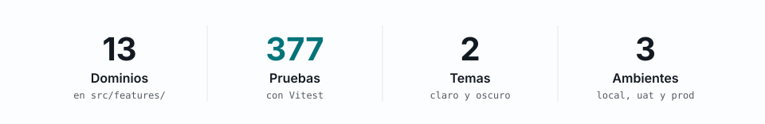
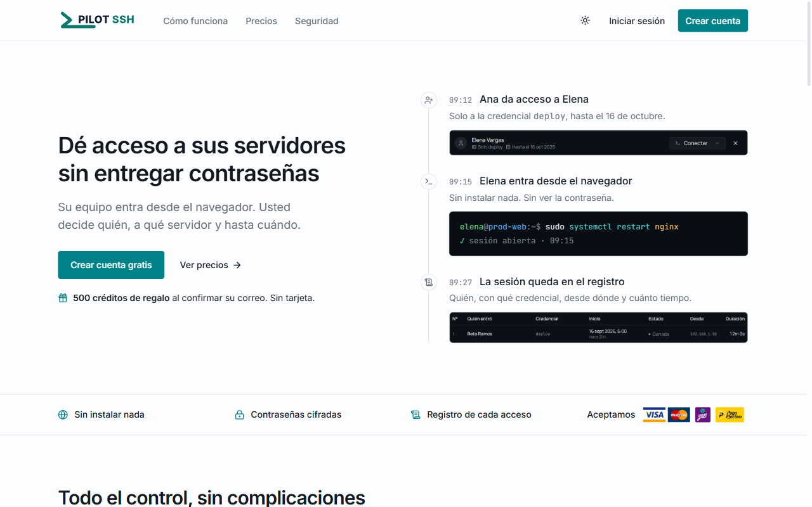
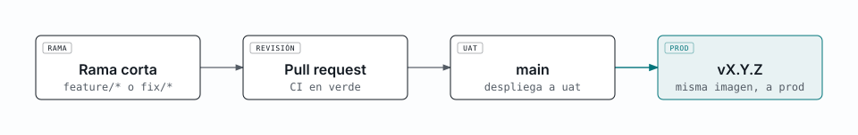

<p align="center">
  <picture>
    <source media="(prefers-color-scheme: dark)" srcset="public/marca/imagotipo-oscuro.svg">
    
  </picture>
</p>

<h1 align="center">Pilot SSH Web</h1>

<p align="center">Sitio público y panel de Pilot SSH para dar acceso a servidores por equipo y abrir la terminal en el navegador.</p>

<p align="center">
  <a href="https://github.com/ABItech-PERU/pilot-ssh-web/actions/workflows/deploy-uat.yml"></a>
  
  
  <a href="LICENSE"></a>
</p>

<picture>
  <source media="(prefers-color-scheme: dark)" srcset="docs/diagramas/cifras-dark.svg">
  
</picture>

<picture>
  <source media="(prefers-color-scheme: dark)" srcset="docs/imagenes/inicio-oscuro.png">
  
</picture>

## Qué resuelve

<table>
  <tr>
    <td width="50%" valign="top">
      <picture><source media="(prefers-color-scheme: dark)" srcset="docs/iconos/buscar-dark.svg"></picture><br><strong>Sitio público prerenderizado</strong><br>Inicio, precios, seguridad y páginas legales listos para buscadores y vistas previas.
    </td>
    <td width="50%" valign="top">
      <picture><source media="(prefers-color-scheme: dark)" srcset="docs/iconos/usuarios-dark.svg"></picture><br><strong>Panel de cada organización</strong><br>Servidores, credenciales, equipo, accesos, auditoría y créditos en un solo lugar.
    </td>
  </tr>
  <tr>
    <td width="50%" valign="top">
      <picture><source media="(prefers-color-scheme: dark)" srcset="docs/iconos/terminal-dark.svg"></picture><br><strong>Terminal en el navegador</strong><br>xterm.js por WebSocket, que se reconecta cuando la API se actualiza.
    </td>
    <td width="50%" valign="top">
      <picture><source media="(prefers-color-scheme: dark)" srcset="docs/iconos/moneda-dark.svg"></picture><br><strong>Recargas sin salir del panel</strong><br>Mercado Pago con tarjeta, Yape y PagoEfectivo.
    </td>
  </tr>
  <tr>
    <td width="50%" valign="top">
      <picture><source media="(prefers-color-scheme: dark)" srcset="docs/iconos/personal-dark.svg"></picture><br><strong>Panel de plataforma</strong><br>Soporte, finanzas y operaciones del personal de Pilot SSH.
    </td>
    <td width="50%" valign="top">
      <picture><source media="(prefers-color-scheme: dark)" srcset="docs/iconos/contenedor-dark.svg"></picture><br><strong>Una imagen para todo</strong><br>La misma imagen corre en local, uat y prod; cada ambiente la configura al arrancar.
    </td>
  </tr>
</table>

## Requisitos

| Herramienta                                                    | Versión                         |
| -------------------------------------------------------------- | ------------------------------- |
| Docker Desktop, con Swarm activo                               | Docker Engine 29                |
| Git Bash                                                       | la incluida en Git para Windows |
| [Pilot SSH API](https://github.com/ABItech-PERU/pilot-ssh-api) | en ejecución local              |

La imagen incluye Node 26.13, React 19, TypeScript 6, Vite 8 y Tailwind 4,
por lo que no es necesario instalarlos en el equipo.

## Inicio rápido

```bash
cp .env.example .env
sh deploy/docker/desplegar.sh
```

La web se publica en `http://localhost:5190`. La guía detallada se
encuentra en [docs/desarrollo.md](docs/desarrollo.md).

## Uso

| Comando                         | Para qué                                                  |
| ------------------------------- | --------------------------------------------------------- |
| `sh deploy/docker/desplegar.sh` | Levantar o actualizar la web en local, sin corte          |
| `sh deploy/docker/pruebas.sh`   | Comprobar los tipos y correr las pruebas en el contenedor |

## Ambientes

<picture>
  <source media="(prefers-color-scheme: dark)" srcset="docs/diagramas/ambientes-dark.svg">
  
</picture>

Los tres ambientes, `local`, `uat` y `prod`, usan el mismo
`docker-compose.yml` y la misma imagen; cada uno la configura al arrancar con
su propio `.env`.

## Documentación

| Quiero…                                         | Documento                                   |
| ----------------------------------------------- | ------------------------------------------- |
| Programar en mi equipo                          | [desarrollo.md](docs/desarrollo.md)         |
| Instalarla en un servidor                       | [deployment.md](docs/deployment.md)         |
| Configurar el despliegue automático             | [github-actions.md](docs/github-actions.md) |
| Saber qué va en el `.env`                       | [entorno.md](docs/entorno.md)               |
| Entender rutas, prerenderizado, SEO y cabeceras | [arquitectura.md](docs/arquitectura.md)     |
| Usar o regenerar la marca                       | [marca.md](docs/marca.md)                   |

## Estructura

```text
src/features/     un dominio por carpeta, con su api.ts y sus pantallas
src/layouts/      PublicLayout, GuestLayout, AppLayout y PlatformLayout
src/routes/       rutas y guardas
src/components/   piezas compartidas; ui/ contiene los componentes de shadcn
src/lib/          http, errores y formato; env.ts lee config.js
public/           marca, favicon y tema.js
scripts/          prerenderizado y utilidades
deploy/docker/    nginx, arranque y scripts de despliegue y pruebas
docs/             documentación y diagramas con su fuente
```

## Contribuir

El trabajo se hace en ramas cortas desde `main` (`feature/*`, `fix/*`) y
entra por PR con la CI en verde. Antes de abrir el PR,
`sh deploy/docker/pruebas.sh` debe terminar sin errores.

## Licencia

Copyright © 2026 ABItech Perú. Todos los derechos reservados.

Software propietario. Las condiciones de uso figuran en [LICENSE](LICENSE).
