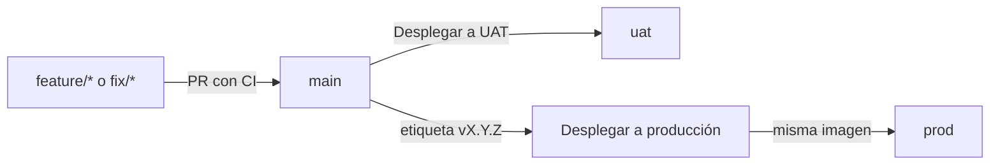

# GitHub Actions

Cómo llega un cambio de la web a `uat` y a `prod`, qué corre cada workflow y qué
hay que configurar. Es el mismo flujo que la API; la decisión está en su
[ADR 0001](../../pilot-ssh-api/docs/decisiones/0001-ramas-y-despliegue.md) y
los detalles comunes, en su [guía](../../pilot-ssh-api/docs/github-actions.md).

## Flujo de un cambio



1. Cree la rama desde `main` y abra el PR a `main`. Corre la CI.
2. Una el PR. **Desplegar a UAT** prueba otra vez, construye la imagen, la
   despliega en `uat` y espera a que `/version.txt` muestre la versión nueva.
3. Revise el cambio en `uat`.
4. Publíquelo con una etiqueta sobre ese commit de `main`:

   ```bash
   git tag v1.4.0 && git push origin v1.4.0
   ```

   **Desplegar a producción** promueve la imagen que ya corre en `uat`.

Para volver a una versión anterior: _Actions → Desplegar a producción → Run
workflow_, con la etiqueta anterior en _Use workflow from_.

## Workflows

| Archivo           | Cuándo corre                                          | Qué hace                                                                                                             |
| ----------------- | ----------------------------------------------------- | -------------------------------------------------------------------------------------------------------------------- |
| `ci.yml`          | PR a `main`; lo llaman los despliegues                | `security` (Gitleaks y `npm audit`) y `frontend` (`npm run typecheck` y `npm test`)                                  |
| `build-image.yml` | Lo llaman los despliegues                             | Construye `pilotssh-web`, la prueba, la revisa con Trivy y la publica. Si la huella ya existe, no recompila          |
| `deploy.yml`      | Lo llaman los despliegues                             | Pone la etiqueta del ambiente, avisa a Dokploy por su webhook y espera la versión nueva y las cabeceras de seguridad |
| `deploy-uat.yml`  | Push a `main` que no sea solo documentación, o a mano | `ci` → imagen → `uat`                                                                                                |
| `deploy-prod.yml` | Etiqueta `v*` de un commit de `main`, o a mano        | Busca la imagen de esa huella. Sin ella, `ci` → imagen. Luego `prod`                                                 |

## Imágenes

`ghcr.io/abitech-peru/pilotssh-web`, con las mismas etiquetas que la API:
`arbol-<huella>` y `sha-<commit>`, que no cambian, y `uat` · `prod`, que apuntan
a la última de cada ambiente. La huella va en `/version.txt`.

## Configurar GitHub

1. _Settings → General → Default branch_: `main`.
2. _Settings → Branches_: en `main`, exigir _pull request_ y que pase la CI.
   El repositorio es público, así que el plan Free lo permite.
3. _Settings → Environments_: `uat` (rama `main`) y `prod` (etiquetas
   `v*`), con las mismas variables y secretos que la API, salvo que la
   dirección de la espera es `WEB_URL`, la de la web, sin `/` al final.

Dokploy se configura igual que en la API:
[Con Dokploy](../../pilot-ssh-api/docs/github-actions.md#con-dokploy), con
el secreto `DOKPLOY_WEBHOOK_URL` del servicio de la web.

## Problemas frecuentes

| Síntoma                                              | Causa                                                                                       |
| ---------------------------------------------------- | ------------------------------------------------------------------------------------------- |
| `Falta la variable WEB_URL en el ambiente uat`       | Falta la dirección de la web en el ambiente                                                 |
| Falla `Auditar paquetes (npm audit)`                 | Una dependencia de producción tiene una vulnerabilidad alta: suba la versión que la corrige |
| Se queda en `Esperar la versión nueva` hasta el tope | El contenedor no arrancó: sin la API no prerenderiza y Swarm mantiene la versión anterior   |
